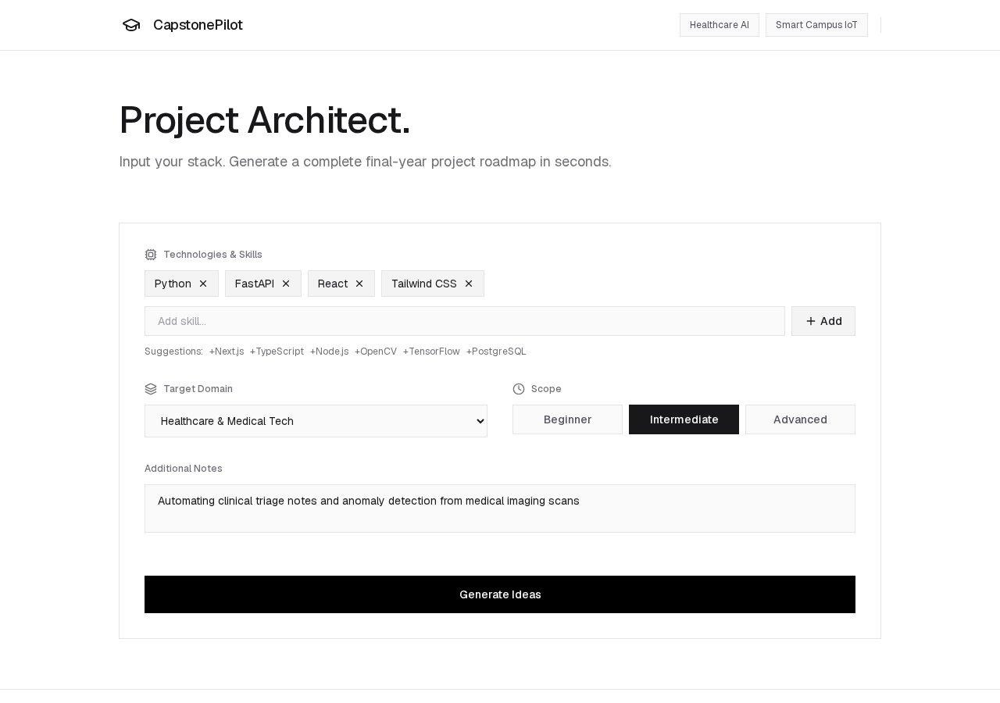

<div align="center">

# PromptWar

**AI project blueprints for final-year capstones.**

Turn your skills and interests into project ideas, then into a step-by-step execution blueprint. The app's in-page name is **CapstonePilot**.


**[Live app →](https://promptwar-chi.vercel.app)**



</div>

---

## ✨ Features

- **Profile:** add skills, pick a domain and a difficulty (Beginner, Intermediate, Advanced), and describe your interests. The header has two presets to start from: *Healthcare AI* and *Smart Campus IoT*.
- **Project ideas:** *Generate Ideas* returns three distinct concepts, each as a card.
- **Blueprint:** select an idea to get a blueprint with tabs for MVP and stretch features, tech stack, a 4-phase roadmap, viva questions, improvements, and a scored audit.
- **Roadmap code:** each roadmap task can generate starter code with the model, shown as Markdown. Your ticked-off progress is saved in your browser.
- **Export:** copy the blueprint as Markdown, download it as a `.md` synopsis, or print it (the browser's print dialog can save a PDF).

## 🚀 Getting started

**Requirements:** Node.js 20.9 or newer (for Next.js 16).

```bash
git clone https://github.com/mtarvecha660-lgtm/promptwar.git
cd promptwar
npm install            # or yarn / pnpm / bun
```

**AI mode (optional):** create `.env.local` with a Gemini API key:

```bash
GEMINI_API_KEY=your-key-here
```

Without a key the app still runs: ideas and blueprints come from the built-in generators in `src/lib/gemini.ts`.

```bash
npm run dev            # http://localhost:3000
npm run build          # production build
npm start              # serve the production build
npm run lint           # ESLint
```

## 🧭 How it works

| Route | What it does |
|-------|--------------|
| `POST /api/generate-ideas` | Asks Gemini (`gemini-2.5-flash`, JSON output) for 3 project ideas |
| `POST /api/generate-blueprint` | Builds a full blueprint for the selected idea |
| `POST /api/generate-step-code` | Writes starter code for one roadmap task |

## 🗂️ Project structure

```
src/
├─ app/              App Router: layout, home page and the three API routes
├─ components/       Header, ProfileForm, IdeaCard, BlueprintView, RoadmapSection, MentorChat
├─ lib/              gemini.ts (model calls and fallback generators), mockData.ts (sample data), firebase.ts
└─ types/            project.ts: profile, idea and blueprint types
```

`MentorChat` and `firebase.ts` are in the code but are not used by the page.

## 📦 Deploy

The simplest route is [Vercel](https://vercel.com): import the repository, and it detects Next.js and runs `npm install && npm run build`. Add `GEMINI_API_KEY` under the project's environment variables to turn on AI mode.

## 🛠️ Tech stack

Next.js 16 (App Router) · React 19 · TypeScript · Tailwind CSS 4 · `@google/genai` · react-markdown · lucide-react

## ⚠️ Limitations

- If an AI request fails, the page quietly shows built-in sample ideas or blueprints instead of an error message.
- Without `GEMINI_API_KEY`, ideas and blueprints are template output, not model output.
- The page is light-themed only; the dark-mode toggle was removed.
- There are no automated tests in the repo.
